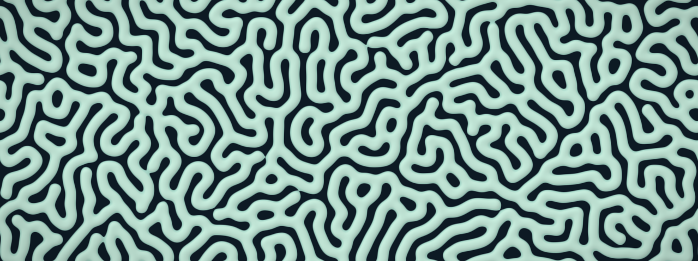
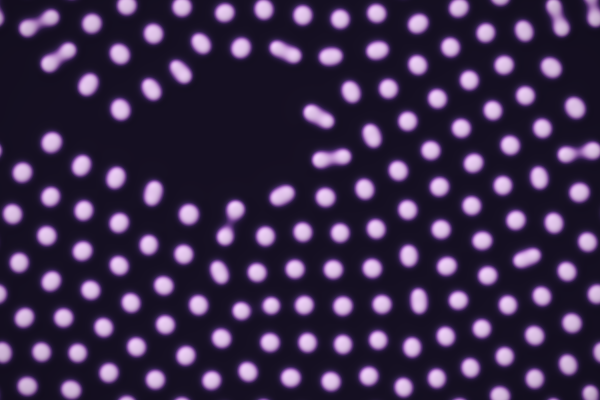
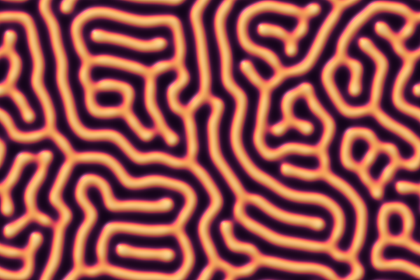
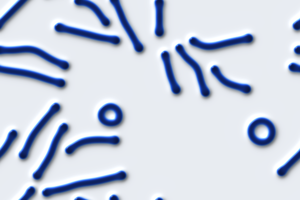
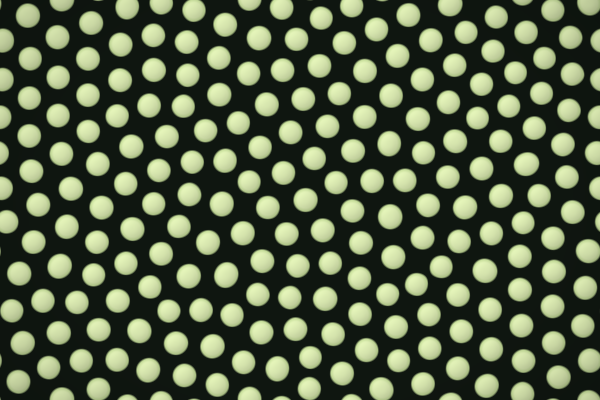
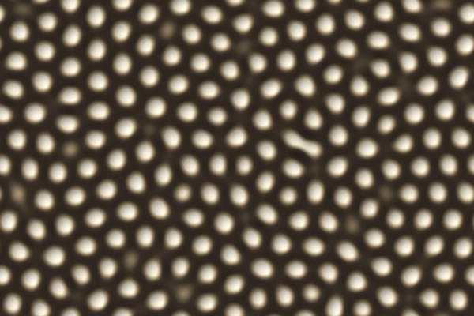
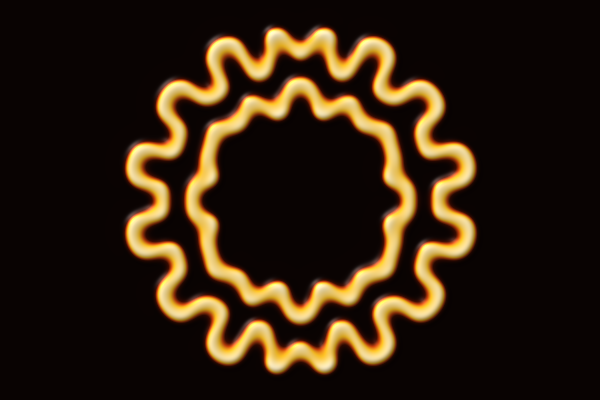

<h1 align="center">petri<sup>.</sup></h1>

<p align="center">
  <i>A reaction-diffusion petri dish in your browser.</i><br>
  Grow coral, fingerprints and dividing cells with your cursor. Everything runs on the GPU and ships as about 8 KB of gzipped JavaScript.
</p>

<p align="center">
  <a href="https://lukietoo.github.io/petri/"></a>
  <a href="https://github.com/Lukietoo/petri/actions/workflows/ci.yml"></a>
  
  
  <a href="LICENSE"></a>
</p>

---

<table>
  <tr>
    <td width="33%"></td>
    <td width="33%"></td>
    <td width="33%"></td>
  </tr>
  <tr>
    <td align="center"><b>mitosis</b> · <code>orchid</code></td>
    <td align="center"><b>maze</b> · <code>sunset</code></td>
    <td align="center"><b>worms</b> · <code>ice</code></td>
  </tr>
  <tr>
    <td></td>
    <td></td>
    <td></td>
  </tr>
  <tr>
    <td align="center"><b>spots</b> · <code>toxic</code></td>
    <td align="center"><b>holes</b> · <code>paper</code></td>
    <td align="center"><b>coral</b> · <code>ember</code> · ring seed</td>
  </tr>
</table>

<sub>Every image here was rendered headlessly with <code>npm run render</code>, using the CPU twin of the GPU shader.</sub>

## What's in the dish

Two virtual chemicals, **A** (the substrate) and **B** (the catalyst), spread across a grid and react:

$$
\begin{aligned}
\frac{\partial A}{\partial t} &= D_A \nabla^2 A \;-\; AB^2 \;+\; f\,(1 - A) \\
\frac{\partial B}{\partial t} &= D_B \nabla^2 B \;+\; AB^2 \;-\; (k + f)\,B
\end{aligned}
$$

B eats A to make more of itself, A is fed in at rate **f**, and B dies off at rate **k**. That's the whole model
(Gray-Scott), and depending on just those two numbers it produces spots, stripes, mazes, solitons and self-replicating cells.

## Features

- 🧫 **Paint live.** Drag to inoculate, and shift-drag or right-drag to sterilise.
- 🧬 **Nine species**: coral, mitosis, maze, spots, worms, holes, waves, chaos and u-skate. Press <kbd>1</kbd> to <kbd>9</kbd>.
- 🗺️ **Parameter map**: sweeps feed along Y and kill along X so every regime grows side by side, and one click picks the species under the cursor.
- 🔤 **Grow a word**: type text and it gets planted in the dish as glyph outlines.
- 🎨 **Seven stains** with a wet emboss shader for a 3D, under-the-microscope look.
- 🔗 **Linkable dishes**: chemistry, stain and seed live in the URL hash.
- 📸 **Snapshots** to PNG, plus a zen mode (<kbd>H</kbd>) for screen recordings.
- 🖥️ **Headless renderer** for wallpapers and CI-friendly images.

## Species

| # | Species | feed `f` | kill `k` | Looks like |
|---|---------|---------:|---------:|------------|
| 1 | Coral   | 0.0545 | 0.0620 | branching growth that fills the dish |
| 2 | Mitosis | 0.0367 | 0.0649 | spots that grow and divide like cells |
| 3 | Maze    | 0.0290 | 0.0570 | labyrinths and fingerprints |
| 4 | Spots   | 0.0300 | 0.0620 | stable solitons, leopard print |
| 5 | Worms   | 0.0780 | 0.0610 | short wriggling segments |
| 6 | Holes   | 0.0390 | 0.0580 | negative spots punched in a sheet |
| 7 | Waves   | 0.0140 | 0.0540 | pulsing, travelling fronts |
| 8 | Chaos   | 0.0260 | 0.0510 | turbulent, never settles |
| 9 | U-Skate | 0.0620 | 0.0609 | gliders on the edge of stability |

## Controls

| Input | Action |
|---|---|
| drag | paint catalyst |
| shift-drag / right-drag | erase |
| <kbd>1</kbd>–<kbd>9</kbd> | switch species |
| <kbd>M</kbd> | toggle parameter map |
| <kbd>C</kbd> | cycle stain |
| <kbd>R</kbd> | fresh culture |
| <kbd>Space</kbd> | pause (you can still paint) |
| <kbd>S</kbd> | snapshot PNG |
| <kbd>H</kbd> | zen mode |

## Getting started

```bash
git clone https://github.com/Lukietoo/petri
cd petri
npm install
npm run dev
```

Needs a browser with WebGL2 and `EXT_color_buffer_float`, which covers every current desktop browser and most phones.

### Headless rendering

```bash
npm run render -- --preset mitosis --palette orchid --seed noise --size 640x400 --steps 9000 --out cells.png
```

`npm run render -- --help` lists every flag. The renderer is plain TypeScript with no native dependencies, and it even writes its own PNGs.

## How it works

```
 pointer ─┐
          ▼
   ┌─────────────┐  ping   ┌─────────────┐
   │ RGBA32F tex │ ──────▶ │ RGBA32F tex │   stepFrag × N per frame
   │  r=A  g=B   │ ◀────── │  r=A  g=B   │   (3×3 Laplacian, wraps)
   └─────────────┘  pong   └─────────────┘
          │
          ▼
   displayFrag: (B−A) → 5-stop ramp → emboss + specular → canvas
```

```
src/
  gl/         WebGL2 plumbing and GLSL (step + display passes)
  core/       pure TS: presets, palettes, seeds, URL state, CPU Gray-Scott
  ui/         side panel
  app.ts      simulation loop, brush, resize, snapshots
scripts/      headless renderer and a tiny PNG encoder
test/         vitest suites
```

- **Ping-pong float textures.** State lives in two `RGBA32F` framebuffers. Each step reads one and writes the other, and the speed slider sets how many steps run per frame.
- **Toroidal world.** `REPEAT` sampling makes the dish wrap at the edges, so there are no hard boundaries.
- **CPU twin.** `core/grayscott.ts` runs exactly the same stencil in TypeScript. That lets tests check real behaviour (coral spreads, high kill wipes out B, edges wrap) without a GPU.
- **Fake depth.** The display pass treats the concentration as a height map, takes its gradient for a normal, and lights it, which gives the glossy, gel-like relief.

## Scripts

| Command | |
|---|---|
| `npm run dev` | Vite dev server |
| `npm run build` | typecheck and production build to `dist/` |
| `npm test` | vitest suites |
| `npm run render` | headless PNG renderer |

## Further reading

- Karl Sims, *Reaction-Diffusion Tutorial*
- Robert Munafo, *Reaction-Diffusion by the Gray-Scott Model: Pearson's Parametrization*
- John E. Pearson, "Complex Patterns in a Simple System", *Science* (1993)
- Alan Turing, "The Chemical Basis of Morphogenesis" (1952)

## License

[MIT](LICENSE)
